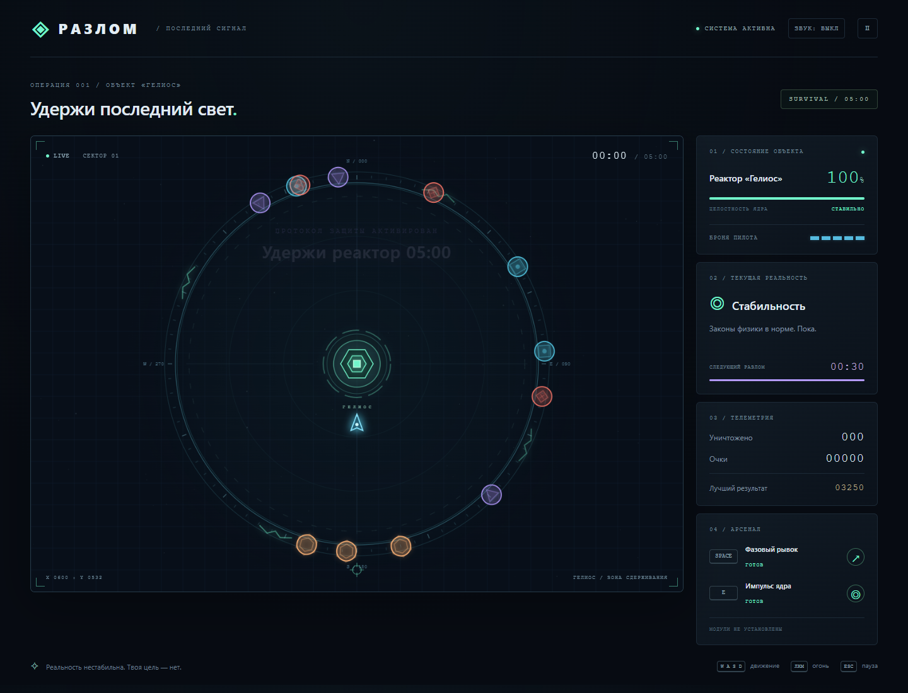

# RIFT: Last Signal

**Version 1.0.0** — A neon survival game built with vanilla JavaScript and Canvas 2D.

One pilot. One reactor. Five minutes to hold the last light.

Defend the Helios reactor against creatures emerging from unstable rifts. Every 30 seconds, reality changes: adapt to new physics, choose upgrades, and survive the next wave. Keep both the reactor and your pilot alive until the rift closes.



## Play

Download and extract the source files, then open **index.html** in a modern browser. No installation, build step, server, or internet connection is required to play.

The in-game interface is currently in Russian. Project documentation is in English.

Optional local preview with Node.js:

```sh
node serve.cjs
```

Open the address printed in the terminal, normally http://127.0.0.1:4173. Stop the server with Ctrl+C.

## Features

- Five-minute survival campaign with ten sectors.
- Reality shifts every 30 seconds: acceleration, gravity, fragmentation, darkness, weapon overload, inertia, swarms, shockwaves, and a final combined anomaly.
- Six enemy types, including ranged attackers, heavy units, and rift guardians in sectors 4, 7, and 10.
- Eight upgrade modules: damage, fire rate, extra projectiles, repair, dash, pulse, mobility, and piercing shots.
- Phase dash with temporary invulnerability and contact damage.
- Reactor pulse that damages and pushes back enemies and clears nearby hostile projectiles.
- Repair pickups, score combos, and local high scores when browser storage is available.
- Procedural neon graphics, particles, and synthesized audio. Enable sound in the header.
- Touch controls with a virtual joystick, ability buttons, automatic aiming, and automatic shooting.
- Automatic pause when the game loses focus.
- No runtime dependencies or external assets.

## Controls

| Action | Input |
| --- | --- |
| Move | WASD or arrow keys |
| Aim | Mouse |
| Fire | Hold left mouse button or F |
| Phase dash | Space |
| Reactor pulse | E |
| Pause / resume | Esc |
| Choose an upgrade | 1, 2, 3 or click |
| Start from the menu | Enter or click |

On touch devices, use the left joystick to move and the right buttons for abilities. Aiming and shooting are automatic.

## Survival tips

- The pulse originates at the **reactor**, not the pilot.
- Dash through enemies or dangerous gaps to avoid damage.
- Collect green shards to repair the reactor.
- Sector transitions restore 8 reactor health and one pilot armor unit, in addition to the chosen module.
- The game pauses during upgrade selection.

## Project structure

```text
index.html          Game interface
style.css           Styling and responsive layout
game.js             Game loop, combat, rendering, upgrades, and audio
serve.cjs           Optional local preview server
verify.cjs          Browser verification script
RELEASE_NOTES.md    Version 1.0 release notes
docs/preview.png    Game screenshot
```

## Verification

Version 1.0 passed 32 game-mechanic checks plus real mouse and keyboard input checks and desktop/mobile layout checks in a Chromium-based browser. No JavaScript errors were observed in the tested scenarios. Progression and victory conditions were exercised through accelerated simulations; the full campaign was not manually playtested to victory.

To run verification with Node.js:

```sh
npm install --no-save playwright
npx playwright install chromium
node verify.cjs
```

The script can also use an installed Edge or Chrome browser. Set BROWSER_PATH to select a browser executable or PLAYWRIGHT_PATH for an alternative Playwright module location. Screenshots and the report are saved to artifacts/.

## GitHub Pages

Upload the files to the repository root. In **Settings → Pages**, select **Deploy from a branch**, **main**, and **/ (root)**. Save and wait for publication. No build step is needed.

## Credits

Created in collaboration with OpenAI Codex. Graphics and audio are generated by the game code; no third-party art or music is bundled.
